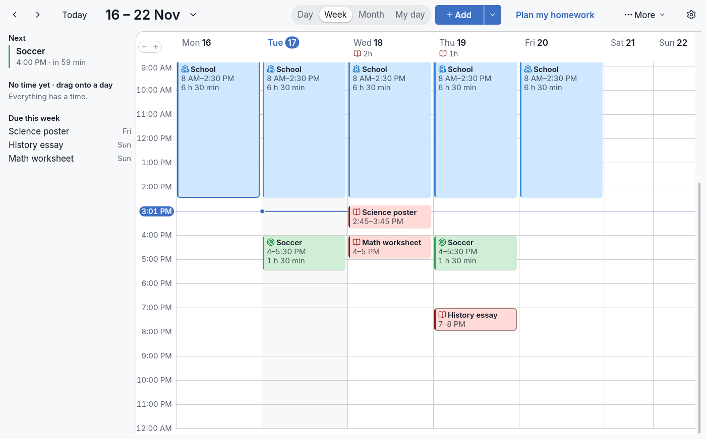
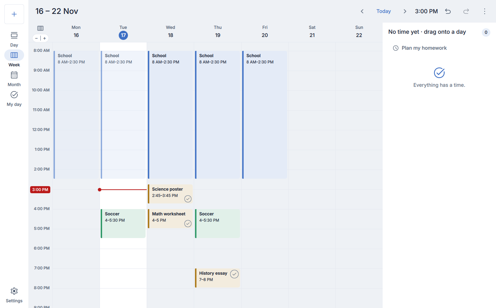
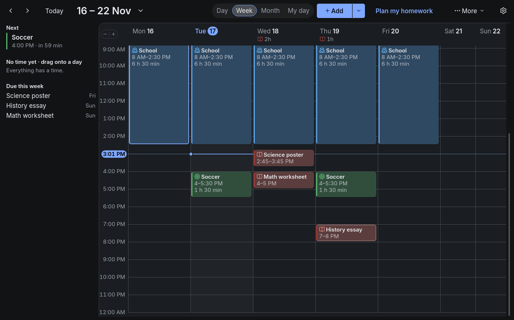
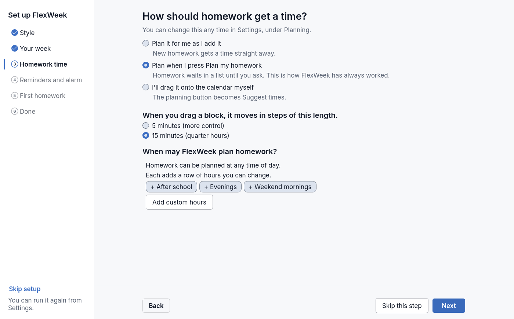

# FlexWeek

Places homework around school and sports, then explains why something moved.

FlexWeek is a weekly planner for high school students who juggle classes, sports, activities and homework. You
enter the fixed parts of your week (school, practice, lessons) and your homework with its due date and how long it
takes. FlexWeek finds free time for each homework before it is due, keeps the times you chose yourself, and says in
plain words what it placed, what it moved and what did not fit. It runs on your own computer: your week is saved there,
it needs no internet, and it uses no AI service. Made for the Congressional App Challenge 2026.



## Features

- **Plan my homework** places each homework in free time before it is due, around fixed times, and explains anything
  it could not place. Replan all starts fresh; homework you placed by hand stays where you put it.
- **Spread over days or in one go**: long homework can be split across the days before it is due, or kept whole.
- **Missed time is made up**: a session whose time passed unfinished is planned again in time still ahead.
- **Week, Day, Month and My day** screens; drag a block to move it, drag its edge to resize it, and Undo puts it back.
- **Your week, your way**: the week can start on any day; School hours and activities repeat every week, with one-week
  changes when you need them.
- **Focus timer** that counts toward the homework it is for, and **reminders and alarms** for what comes next.
- **Two styles**: the standard style, with several page designs, ten colour themes and an editor for your own, and a
  Material 3 style; both light and dark, with keyboard shortcuts throughout.
- **Phone app** for Android that syncs with your computer, and an optional **assistant helper** for AI assistants
  that speak MCP.

## Download

From the [latest GitHub Release](https://github.com/j0nsh1n/FlexWeek/releases/latest):

- **Download for Windows.** `FlexWeek-Windows-x64-Setup.exe`
- **Download for Linux.** `FlexWeek-Linux-x86_64.tar.gz`, or `FlexWeek-x86_64.AppImage`
- **Download for Android.** `FlexWeek-Android-<version>.apk` (the version is part of the file name), on the same page. See [Phone app](#phone-app).

Checksum files (`.sha256`) sit next to those downloads if you want to confirm the file is complete. You can ignore them and still open FlexWeek.

**Windows.** Run `FlexWeek-Windows-x64-Setup.exe`. It installs FlexWeek for your Windows account without an administrator, then open FlexWeek from the Start menu. If Windows shows "Windows protected your PC", choose More info, then Run anyway. FlexWeek is not code-signed yet; the warning is SmartScreen not recognizing a new publisher, not a virus finding. Schools and IT can deploy `FlexWeek-Windows-x64.msi` instead, which installs for every account on the PC. Uninstall from Settings, then Apps.

**Linux.** Extract the archive and open the file named FlexWeek. You need a 64-bit Linux desktop (GNOME, KDE Plasma, Cinnamon, Xfce), glibc 2.38 or newer (Ubuntu 24.04, Linux Mint 22, Debian 13, Fedora 39 or newer), and working graphics (OpenGL or EGL). A remote or headless session without a display will not work. The system libraries it uses are listed under [Linux libraries](#linux-libraries).

**Linux AppImage.** If `FlexWeek-x86_64.AppImage` won't start (missing FUSE), run `chmod +x FlexWeek-x86_64.AppImage && ./FlexWeek-x86_64.AppImage --appimage-extract`, which unpacks a `squashfs-root` folder, then run `./squashfs-root/AppRun`. Without FUSE, the tarball above is the reliable choice.

**Chromebooks.** Not supported. FlexWeek is a Windows and Linux desktop app; there is no web version.

## First run

1. Open FlexWeek. The first screen is Sign in. Choose "New here? Create an account" under it and pick a username and a password. The account and your week are saved on this computer; nothing is sent anywhere.
2. Save the recovery codes FlexWeek shows next. One of them resets your password if you forget it.
3. Setup goes a page at a time: a style, your week (school and other fixed times), how homework gets a time, reminders and the alarm sound, and your first homework. You can skip any page and change all of it later in Settings (the gear).
4. Press Plan my homework. FlexWeek places each homework around the fixed times and says, in plain words, anything it could not place or had to move. Drag a block to move it yourself; Undo puts it back.

### Linux libraries

The Linux download carries Qt and Python inside it, including the X11 helpers many desktops leave out (`libxcb-cursor` and five others) and the keyboard libraries `libxkbcommon` and `libxkbcommon-x11`. It uses these libraries from your system, and a desktop install already has them:

| For | Libraries |
| --- | --- |
| Graphics | `libEGL.so.1`, `libGL.so.1` |
| Text | `libfontconfig.so.1`, `libfreetype.so.6` |
| X11 | `libX11.so.6`, `libX11-xcb.so.1`, and `libxcb.so.1` with its `randr`, `render`, `shape`, `shm`, `sync`, `xfixes` and `xkb` parts |
| Wayland | `libwayland-client.so.0`, `libwayland-cursor.so.0`, `libwayland-egl.so.1` |
| Desktop services | `libglib-2.0.so.0`, `libdbus-1.so.3` |
| Network | `libgssapi_krb5.so.2`, `libbrotlidec.so.1` |
| Sound, optional | `libpulse.so.0` from PulseAudio or PipeWire, and `libbz2.so.1`, `libdrm.so.2`, `libXext.so.6` and `libXrandr.so.2` for Qt's sound plugin. Without them, reminders and alarms still show, silently. |

If FlexWeek does not start, this lists any that are missing:

```bash
find FlexWeek -name '*.so*' -exec ldd {} + 2>/dev/null | grep 'not found' | sort -u
```

On Debian or Ubuntu without a full desktop, such as a container or a minimal install, `sudo apt install libegl1 libgl1 libdbus-1-3` adds the ones FlexWeek's own test machines lacked.

## Phone app

FlexWeek also runs on an Android phone (Android 8.0 or newer). Pair it with your computer in Settings > This computer > Devices: the computer shows an 8-digit code, you type it on the phone, and the code works once and lasts 5 minutes. The phone runs the same engine as your computer and syncs your real homework both ways. When your computer isn't on the same Wi-Fi, FlexWeek uses a public relay run by n0. It sees that two devices are talking, not what they send. With no phone linked, the computer opens no network connection and contacts no relay. How to build the app is in [docs/android.md](docs/android.md).

**Get it.** Download `FlexWeek-Android-<version>.apk` from the [latest GitHub Release](https://github.com/j0nsh1n/FlexWeek/releases/latest), open it on the phone and allow installs from your browser or file manager when Android asks. The app is signed with the project's own key, not Google Play's. After that, the app offers each new release itself (Settings), and installing it over the old one keeps your data. The phone has Today, Week, Add homework, Plan, Running late, a focus timer, reminders and an Up next home-screen widget, and syncs; it does not have Month or Day screens.

## Assistant helper

The Linux downloads include a helper that lets an AI assistant you already use (any program that speaks MCP, such as a desktop chat app) work with your FlexWeek schedule. Start it with `./FlexWeek --mcp --read-only` from the extracted tarball, or `./FlexWeek-x86_64.AppImage --mcp --read-only`, and point the assistant at that command. With `--read-only` the assistant can only look. Without it, the assistant can plan homework for a day or a week, add and change breaks and events, mark things done, and bring back an earlier version of the schedule. Before each change the helper saves a restore point, and a change that clashes with something you changed is refused rather than written over. It works for the account that is signed in to FlexWeek on this computer (it says "Please sign in" when none is) and runs on your computer. FlexWeek itself has no chatbot and calls no AI service; the helper only passes your assistant's requests to the same planner the app uses. The Windows and Android downloads do not include it.

## Screenshots

| Material 3 style | Dark theme |
| --- | --- |
|  |  |

| First-run setup |
| --- |
|  |

## Tech stack

- **Desktop app**: Python 3.14 with Qt (PySide6), Widgets and QML (Material 3).
- **Planner and storage**: Rust (`engine/`), built into a Python module with PyO3 and maturin; SQLite (rusqlite).
- **Saved data**: the Rust service answers the window in the same process; there is no server.
- **Phone app**: Android, Kotlin with Jetpack Compose, calling the same Rust engine through UniFFI; sync uses iroh.
- **Packaging**: Linux tarball and AppImage built on Depot CI, Windows installers (Inno Setup and WiX) built on GitHub Actions.

## Run from source

Requires Python 3.14 and Rust (install it with [rustup](https://rustup.rs); the version is pinned in `rust-toolchain.toml`). The planner and the storage are written in Rust and built into a Python module the app imports.

```bash
python -m venv .venv
source .venv/bin/activate   # Windows: .venv\Scripts\activate
pip install -r requirements.txt
pip install -r requirements-desktop.txt
pip install ./engine/py     # builds the Rust engine; run it again after pulling changes to engine/
python -m desktop.main
```

On Linux, pip's PySide6 does not include the X11 helpers and keyboard libraries that the download carries, so a checkout also needs `libxcb-cursor.so.0`, `libxcb-icccm.so.4`, `libxcb-image.so.0`, `libxcb-keysyms.so.1`, `libxcb-render-util.so.0`, `libxcb-util.so.1`, `libxkbcommon.so.0` and `libxkbcommon-x11.so.0`, besides the [Linux libraries](#linux-libraries) above. On Debian or Ubuntu: `sudo apt install libxcb-cursor0 libxcb-icccm4 libxcb-image0 libxcb-keysyms1 libxcb-render-util0 libxcb-util1 libxkbcommon0 libxkbcommon-x11-0`.

Building the Linux download (`./desktop/build_linux.sh`) also needs a C compiler (GCC), Python 3.14's development headers, `patchelf` (installed by `requirements-desktop.txt`) and `readelf` (binutils). The six X11 helpers and the two xkbcommon libraries must be installed, because the build copies them into the bundle. A release is built on Ubuntu 24.04, so nothing in it needs a glibc newer than 2.38; [DESKTOP.md](DESKTOP.md) has the details.

The app reads and saves your week itself; there is no server to run and no page to open in a browser.

## Using FlexWeek

Usernames use 3–32 letters, numbers or underscores, and passwords 12–128 characters. A forgotten password is reset with
one of the eight recovery codes shown when the account was made.

- **Adding**: press **Add** in the top bar for homework, or its arrow for a fixed time or School hours, or drag on the
  calendar. A **fixed time** (school, practice) never moves when you plan; **homework** is placed by Plan my homework
  in free time before it is due.
- **Changing**: a click opens anything on the calendar, and a right-click offers Open, Duplicate, Finished and Delete.
  Undo brings back what you deleted or moved. Ctrl+K finds any action or homework by typing.
- **Saving**: every change saves on its own a moment later and retries if a save fails. A save that clashes with
  another window is never written over; FlexWeek asks you to reload the saved week instead.
- **Looks**: the look starts on System, which follows your device's light or dark setting. Settings (the gear) holds
  the look and layout: Today's app and Timeline are the standard designs, the rest are under Experimental styles, and
  **Customise…** edits any of the ten colour themes and saves it as your own. Material 3 is one more style, chosen
  under Settings > Look, with its own seed colour, palette style and contrast; you can switch back without a restart.
  Animations can be Normal, More, Reduce (fades only) or Off.
- **Older weeks**: a week exported from an older browser-based build can be imported after you sign in. Import
  replaces the current week after you confirm it, and leaves invalid data untouched.

## Data and configuration

FlexWeek keeps its database in your user data folder (on Linux,
`~/.local/share/FlexWeek/flexweek.db`) and reads and saves it itself: it runs no
server and opens no network port (phone sync, once a phone is paired, listens
for that phone). Nothing needs configuring to use it.

| Setting | Effect |
|---|---|
| `--database FILE` | Use this database file instead of the one in your data folder |

The database and its journals are gitignored. Back up the database with SQLite's
backup API or with the app stopped; protect backups as private account data.

## Checks

The checks run through `fwtest`, a small Rust program in `tools/fwtest`. Build
it once, and again after it changes. The tests also need the engine built with
its test-only functions (`--features audit`), and again after `engine/` changes:

```bash
(cd tools/fwtest && cargo build --release)
pip install -r requirements-dev.txt
maturin develop --release --manifest-path engine/py/Cargo.toml --features audit
tools/fwtest/target/release/fwtest gate
```

The engine has its own checks, run in `engine/`: `cargo fmt --check`,
`cargo clippy --workspace -- -D warnings` and `cargo test --workspace`.

`fwtest gate` runs the backend and desktop source checks at low priority, one
suite at a time on the machine, and stops everything it started when it ends.
Where PySide6 is absent, use `fwtest gate --backend-only`; desktop is then
explicitly unverified. `fwtest mutate [SPEC]` checks that the tests catch
deliberate breaks, `fwtest rig ...` drives the app with a real pointer,
`fwtest run -- CMD` runs any other command the same way, and `fwtest clean`
stops what a killed run left behind. It uses `.venv/bin/python` unless you pass
`--python` or set `FWTEST_PYTHON`. The contract is
[docs/tooling/fwtest.md](docs/tooling/fwtest.md). What is checked, and how, is in
spec.md under Validation & Tooling.

## Progress

[CHANGELOG.md](CHANGELOG.md) lists what each version changed, and the [roadmap](roadmap.md) lists what is being worked
on. Developer builds of the newest work are published on GitHub as a pre-release named `dev` (Linux tarball only); turn
them on with Settings > This computer > Get developer builds. Windows packages are built on GitHub Actions when a
release is made; nobody has yet run the installers on a real Windows PC for this project, so a first install there
still needs a person to click through SmartScreen and report back. How the downloads are built and released is in
[DESKTOP.md](DESKTOP.md) and [docs/github-release.md](docs/github-release.md).

AI assistance was used throughout development. These models wrote, reviewed or checked code, tests and documents under
j0nsh1n's direction, who decided what was built and checked what shipped:
- Claude (Anthropic): Opus 5 and 5.5, Fable 5.1 and 5.2, Sonnet 5.5, Haiku 5.5.
- Grok 4.6 and 4.7 (xAI) and Composer 2.5, through Cursor.
- ChatGPT and Codex (OpenAI): GPT-6.1 Sol, GPT-6 Luna.
- GLM-5.3 Flash (Z.ai), through OpenCode.
- Kimi K3.1 Pro (Moonshot AI): bug hunting and picture reviews.
- Jev and Laya (TypeSafe): small models that run on the developer's computer and sort wording and document checks.

The app itself uses no AI service.

## Credits

- **Jonathan Shin** ([j0nsh1n](https://github.com/j0nsh1n)): design, development and direction.
- **Caleb** ([maruzenskymambo](https://github.com/maruzenskymambo)): ideas.
- The saved theme names `nocturne` and `slate` come from Daily Scheduler (the GPL-3.0 `Local-Schedule-Assistant`
  project); FlexWeek's own colours replaced its palette in September 2026.

## License

FlexWeek is free software under the GNU General Public License v3.0; see [LICENSE](LICENSE).
